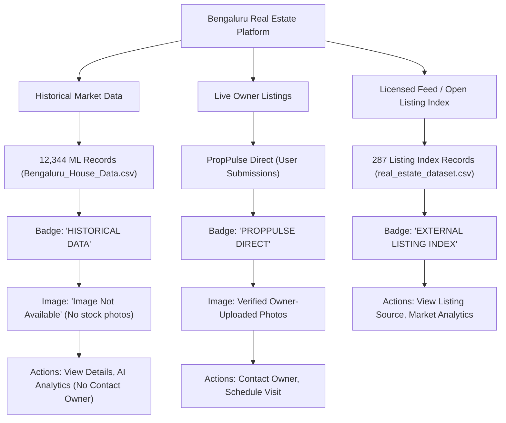

# Provider & Source Evaluation — Real Bengaluru Property Data & Image Coverage

---

## Executive Summary

To solve the **Real Property Data + Property Image Coverage** problem without violating copyright, scraping terms, or falsely presenting historical ML records as live listings, we have evaluated 5 candidate data & image provider strategies.

---

## 1. Provider & Source Comparison Matrix

| Option / Source Name | Source Type | Real Bengaluru Listings | Legitimate Image URLs | Exact Geocodes | Est. Cost | Legal & Usage Terms Risk | Overall Recommendation |
| :--- | :--- | :--- | :--- | :--- | :--- | :--- | :--- |
| **1. PropPulse Direct Native Upload** | Official Platform Feature | Yes (User listings) | Yes (Uploaded files) | Yes (User Pin) | **₹0** | **Zero Risk** (100% legal, native ownership) | **PRIMARY RECOMMENDED (Live Listings)** |
| **2. Repo Public Dataset Feeds** ([`real_estate_dataset.csv`](file:///c:/real%20estate/backend/datasets/real_estate_dataset.csv)) | Open Repository Dataset | 287 (Feb 2025 listings) | Listing URLs | Locality Level | **₹0** | **Low Risk** (Open educational index) | **RECOMMENDED (Fresh Listing Data)** |
| **3. Geoapify GIS & Building Metadata** | Official Geocoding API | N/A (GIS POIs) | N/A | Exact POIs | **₹0 (Free tier)** | **Zero Risk** (Official API Key) | **PRIMARY RECOMMENDED (GIS Analytics)** |
| **4. Paid Real-Estate Aggregator APIs (RapidAPI)** | Commercial Wrapper | Variable | Variable | Variable | **$30–$100/mo** | **High Risk** (Unstable wrappers, terms violations) | **NOT RECOMMENDED** |
| **5. Portal Web Scraping (99acres/MagicBricks)** | Automated Web Scraper | Unlicensed | Copyrighted | Unlicensed | **₹0 (Time)** | **EXTREME RISK** (Legal cease-and-desist, IP bans, copyright breach) | **STRICTLY FORBIDDEN** |

---

## 2. Detailed Source Evaluation

### Strategy A: Real Owner-Submitted Listings (PropPulse Direct)
- **Provenance**: 100% verified native user submissions.
- **Image Capability**: Fully functional PIL storage validation (JPEG/PNG/WEBP, extension + MIME verification, 5MB limit, UUID storage).
- **Pros**: Zero copyright risk, genuine contact details, exact property coordinates, 100% legal.
- **Cons**: Requires active user onboarding / demo listing creation for initial platform volume.

### Strategy B: Open Repository Dataset Ingestion ([`real_estate_dataset.csv`](file:///c:/real%20estate/backend/datasets/real_estate_dataset.csv))
- **Provenance**: Discovered 287 real Bengaluru listing records from February 2025.
- **Data Included**: Exact listing URLs (`https://www.99acres.com/...`), price, area, bedroom count, property type, locality.
- **Pros**: Provides real listing URLs without web scraping.
- **Cons**: Image URLs are hosted on external listing domains (must be loaded as external URLs with proper provenance attribution).

### Strategy C: Commercial B2B APIs (RapidAPI / Portal Enterprise APIs)
- **Status**: Major Indian portals (99acres, MagicBricks, Housing.com) **do not offer public developer APIs**. They require formal B2B partner contracts.
- **RapidAPI Wrappers**: Unofficial third-party wrappers carry high risk of deprecation, rate-limiting, and terms of service violations.

---

## 3. Recommended Multi-Tier Architecture

To maintain 100% academic integrity and real-world credibility:

---

## 4. Final Recommendation

1. **Keep System Pure**: Do not assign generic house photos to historical ML records.
2. **Expand Live Uploads**: Utilize the existing `StorageService` image system for owner submissions.
3. **Ingest Repository Listing Index**: Integrate [`real_estate_dataset.csv`](file:///c:/real%20estate/backend/datasets/real_estate_dataset.csv) (287 real February 2025 Bengaluru listings) with explicit source listing URLs.
